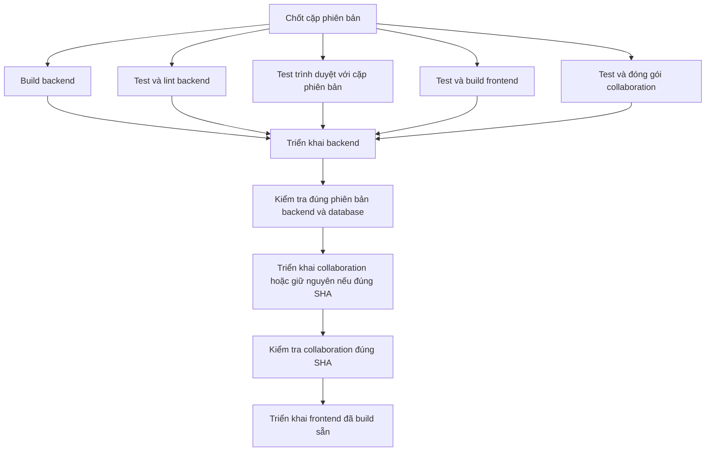

# Vận hành production: VPS và phát hành phối hợp

## 1. Tổng quan

- Repo điều phối: `thienbd203/pathnote` (local `pathnote-rust`). Frontend vẫn là
  `thienbd203/pathnote-web` và `thienbd203/pathnote-collaboration`; Rust điều phối cả ba phiên bản.
- Workflow `.github/workflows/deploy.yml` (**Pathnote coordinated release**): pull
  request chỉ chạy check; push `master` hoặc chạy thủ công trên `master` phát hành
  cặp phiên bản trong `.github/release.json`.
- VPS không cần Rust/Cargo: CI build binary musl `server` và `migration`, upload
  bằng SSH vào `/opt/pathnote-rust/releases/<RELEASE>`, symlink `current`.
- Database mới `pathnote_rust`; không chuyển dữ liệu Laravel, không đổi cấu hình
  Laravel đang chạy.
- Blue–green là chế độ opt-in sau khi chuẩn bị VPS: đọc mục 7 trước khi đổi service
  hoặc bật `DEPLOY_STRATEGY`. Các mục 2–4 giữ hướng dẫn mặc định in-place.

| Thành phần | Nơi chạy | Cổng / URL |
| --- | --- | --- |
| API Rust `pathnote-rust.service` (user `pathnote`) | `/opt/pathnote-rust/current` | `127.0.0.1:3000`, public qua Nginx HTTPS `/health` |
| PostgreSQL | VPS, chỉ localhost | `5432` |
| Frontend tĩnh | `/var/www/pathnote-web` (mặc định) | `https://pathnote.aphorisms.cloud` |
| Collaboration | triển khai riêng | `https://pathnote-collab.aphorisms.cloud/up` |
| Backup trước migration | `/var/backups/pathnote-rust` (link `/opt/pathnote-rust/backups`) | — |

Chỉ public SSH/HTTP/HTTPS. Tác vụ nền chạy trong Rust, không cần Redis/Horizon.
Media phục vụ qua API có kiểm tra quyền.

## 2. Chuẩn bị VPS lần đầu

Ubuntu/Debian, chạy bằng root hoặc sudo.

### 2.1 Gói và PostgreSQL

```sh
cat /etc/os-release
uname -m
sudo apt update
sudo apt install -y postgresql postgresql-contrib rsync python3 util-linux openssl ca-certificates nginx certbot python3-certbot-nginx
sudo systemctl enable --now postgresql
pg_lsclusters
sudo -u postgres psql -c 'SHOW listen_addresses;'
sudo -u postgres psql -c 'SHOW port;'
```

PostgreSQL chỉ nghe localhost; nếu khác, sửa `listen_addresses = 'localhost'` trong
`postgresql.conf` của cluster rồi restart. Dùng bản Ubuntu đang hỗ trợ
([hướng dẫn](https://www.postgresql.org/download/linux/ubuntu/)).

Tạo role/database, nhập password qua prompt (không ghi vào history):

```sh
sudo -u postgres psql
```

```sql
CREATE ROLE pathnote LOGIN;
\password pathnote
CREATE DATABASE pathnote_rust OWNER pathnote;
\q
```

```sh
psql -h 127.0.0.1 -U pathnote -d pathnote_rust -W -c 'SELECT current_database();'
```

Role không cần SUPERUSER; database owner đủ chạy migration và tạo bảng phiên.

Client PostgreSQL phải cùng major version với server (`pg_dump` cũ hơn sẽ từ chối
chạy), ví dụ DB 17:

```sh
sudo apt install postgresql-client-17
/usr/bin/pg_dump --version
sudo -u postgres psql -Atc 'SHOW server_version;'
```

Helper dùng `/usr/bin/pg_dump` (trên Debian là wrapper chọn client theo cluster).
DB không phải local cluster thì cấu hình client mặc định đúng major version.
[Tài liệu pg_dump](https://www.postgresql.org/docs/current/app-pgdump.html).

### 2.2 User, thư mục, khóa JWT

User `pathnote` chạy ứng dụng; `deploy` nhận artifact. Đã có user deploy thì dùng
lại, sửa tên trong sudoers và `SSH_USER`.

```sh
sudo useradd --system --user-group --no-create-home --shell /usr/sbin/nologin pathnote
sudo adduser --disabled-password --gecos '' deploy
sudo usermod -aG pathnote deploy
sudo install -d -o deploy -g pathnote -m 2750 /opt/pathnote-rust /opt/pathnote-rust/releases
sudo install -d -o root -g pathnote -m 750 /opt/pathnote-rust/shared /opt/pathnote-rust/shared/keys
sudo install -d -o pathnote -g pathnote -m 750 /opt/pathnote-rust/shared/media
```

Thêm public key riêng cho CI vào `/home/deploy/.ssh/authorized_keys` (thư mục 700,
file 600, owner deploy); private key chỉ đưa vào GitHub Secret. Đăng nhập SSH lại để
nhóm mới có hiệu lực.

Tạo khóa JWT **một lần**, không ghi đè khi deploy:

```sh
sudo sh -c 'test ! -e /opt/pathnote-rust/shared/keys/access-token.pem && umask 027 && openssl genpkey -algorithm RSA -pkeyopt rsa_keygen_bits:3072 -out /opt/pathnote-rust/shared/keys/access-token.pem'
sudo chown root:pathnote /opt/pathnote-rust/shared/keys/access-token.pem
sudo chmod 640 /opt/pathnote-rust/shared/keys/access-token.pem
```

### 2.3 Env, systemd, helper backup

Từ Mac, trong repo Rust (thay VPS_HOST, thêm port nếu khác 22):

```sh
scp deploy/production.env.example deploy/pathnote-rust.service deploy/database-backup.py deploy/nginx.conf.example root@VPS_HOST:/tmp/
```

Trên VPS:

```sh
sudo install -o root -g pathnote -m 640 /tmp/production.env.example /opt/pathnote-rust/shared/.env
sudo nano /opt/pathnote-rust/shared/.env
sudo install -m 644 /tmp/pathnote-rust.service /etc/systemd/system/pathnote-rust.service
sudo install -d -o root -g root -m 700 /var/backups/pathnote-rust
sudo install -o root -g root -m 755 /tmp/database-backup.py /usr/local/sbin/pathnote-db-backup
sudo ln -s /var/backups/pathnote-rust /opt/pathnote-rust/backups
sudo systemctl daemon-reload
sudo systemctl enable pathnote-rust.service
```

Chưa start service; binary lên ở lần deploy đầu. Quy tắc `.env`:

- Điền DATABASE_URL, Google client ID/secret, FRONTEND_URL, GOOGLE_REDIRECT_URL,
  JWT_ISSUER theo domain thật. Giữ `APP_BIND=127.0.0.1:3000`, `COOKIE_SECURE=true`.
- DATABASE_URL là URL literal một dòng, có hoặc không dấu nháy, không interpolation;
  percent-encode ký tự đặc biệt (`@` → `%40`). File do dotenv/systemd đọc, không
  `source` trong shell; helper không chạy các biến khác.
- Thêm callback Rust vào Authorized redirect URIs trên Google Console (có thể dùng
  chung OAuth client với Laravel). Khóa JWT và MEDIA_ROOT nằm ngoài releases.
- Dịch/IPA chưa chạy thì để trống TRANSLATION_URL/PRONUNCIATION_URL; có rồi thì dùng
  địa chỉ localhost trong mẫu. Realtime cần COLLABORATION_URL WSS và cùng
  COLLABORATION_SECRET giữa Rust/Hocuspocus; Hocuspocus trỏ API nội bộ sang Rust.

Helper backup do root cài cố định; CI không upload/thay nó. Nó chạy `pg_dump` bằng
user ứng dụng (không phải root), tách URL thành các biến libpq (`PGHOST`, `PGPORT`,
`PGUSER`, `PGPASSWORD`, `PGDATABASE`); không truyền nguyên URL vào `PGDATABASE`.
Thông tin kết nối không vào tham số hay log. Helper ghi dump root mode 600,
giữ 5 bản hoàn tất mới nhất; dump lỗi/rỗng làm
deploy dừng trước migration. Đổi DEPLOY_PATH/user thì root sửa hằng số trong helper
cùng sudoers. Không cấp sudo chạy helper từ thư mục releases (deploy có quyền ghi).

Sudoers: `sudo visudo -f /etc/sudoers.d/pathnote-rust`

```sudoers
deploy ALL=(root) NOPASSWD: /usr/bin/systemctl restart pathnote-rust.service, /usr/bin/systemctl stop pathnote-rust.service, /usr/local/sbin/pathnote-db-backup *
deploy ALL=(pathnote) NOPASSWD: /usr/bin/test -r /opt/pathnote-rust/shared/.env, /usr/bin/test -r /opt/pathnote-rust/shared/keys/access-token.pem, /usr/bin/test -w /opt/pathnote-rust/shared/media, /opt/pathnote-rust/releases/*/migration up
```

```sh
sudo chmod 440 /etc/sudoers.d/pathnote-rust
sudo visudo -cf /etc/sudoers.d/pathnote-rust
```

VPS đã có từ trước: cài helper, client và sudoers **trước lần deploy tiếp theo**.
Khi helper thay đổi, upload lại `deploy/database-backup.py` và chạy lại lệnh
`install` ở mục 2.3; chỉ chạy lại CI không cập nhật helper trên VPS.
Helper hỗ trợ URL một host (kể cả IPv6), database và credential percent-encoded;
query hỗ trợ `sslmode`, `sslrootcert`, `sslcert`, `sslkey`, `application_name`,
`options`, `connect_timeout`, `target_session_attrs`. Option khác bị từ chối,
không âm thầm bỏ qua cấu hình kết nối/TLS.

### 2.4 Domain và Nginx HTTPS

`rust-api.example.com` là placeholder; thay ở mọi chỗ trong mẫu và env. Trỏ DNS về
VPS, tạo `sudo nano /etc/nginx/sites-available/pathnote-rust`:

```nginx
server {
    listen 80;
    server_name rust-api.example.com;
    location / { proxy_pass http://127.0.0.1:3000; }
}
```

```sh
sudo ln -s /etc/nginx/sites-available/pathnote-rust /etc/nginx/sites-enabled/pathnote-rust
sudo nginx -t
sudo systemctl reload nginx
sudo certbot --nginx -d rust-api.example.com
```

Sau đó áp thiết lập từ `nginx.conf.example` vào site HTTPS certbot đã tạo, giữ
redirect HTTP → HTTPS, `nginx -t` rồi reload. Không ghi đè site Laravel.

### 2.5 pgAdmin trên Mac qua SSH tunnel

Không cài giao diện quản trị trên VPS, không mở 5432. Add New Server:

| Tab | Trường | Giá trị |
| --- | --- | --- |
| General | Name | Pathnote VPS |
| Connection | Host / Port | 127.0.0.1 / 5432 |
| Connection | Maintenance database / Username | pathnote_rust / pathnote |
| Connection | Password | Password database đã tạo |
| SSH Tunnel | Use SSH tunneling | Yes |
| SSH Tunnel | Tunnel host / Port | VPS_HOST / cổng SSH |
| SSH Tunnel | Username | User SSH của anh |
| SSH Tunnel | Authentication / Identity file | Identity file / khóa SSH trên Mac |

[Tài liệu pgAdmin](https://www.pgadmin.org/docs/pgadmin4/latest/server_dialog.html).

## 3. Secrets và variables GitHub

Workflow không tự tạo/sửa secrets hay variables.

**Repo điều phối — Repository variables/secret** (job build không dùng Environment):

| Tên | Giá trị |
| --- | --- |
| Variable `VITE_API_URL` | Origin API production (bắt buộc cho build frontend) |
| Variable `BUILD_RUNNER` | Mặc định `ubuntu-24.04` (x86_64); `ubuntu-24.04-arm` cho aarch64 |
| Secret `COLLABORATION_READ_TOKEN` | Chỉ khi repo collaboration private và token frontend chưa đọc được repo đó: Contents: read. Workflow ưu tiên token này, rồi FRONTEND_READ_TOKEN, cuối cùng github.token cho repo public |
| Secret `FRONTEND_READ_TOKEN` | Chỉ khi frontend private: token Contents: read cho repo frontend, không quyền ghi/Actions: write. Public thì dùng `github.token` mặc định |

Token chỉ dùng checkout ở job build; không lưu vào cấu hình Git, không đưa token
hay SSH key vào artifact.

**Repo điều phối — Environment `production`:**

| Tên | Giá trị |
| --- | --- |
| Secret `SSH_HOST` | IP hoặc hostname VPS (không protocol/port) |
| Secret `SSH_USER` | deploy |
| Secret `SSH_PORT` | 22 hoặc cổng thực tế |
| Secret `SSH_PRIVATE_KEY` | Private key CI, không passphrase |
| Secret `SSH_KNOWN_HOSTS` | Host key VPS đã xác minh |
| Variable `HEALTHCHECK_URL` | `https://DOMAIN_API_RUST/health` (bắt buộc, không `/` cuối) |
| Variable `DEPLOY_PATH` | Mặc định `/opt/pathnote-rust`; đổi thì sửa service, env, sudoers, helper |
| Variable `WEB_DEPLOY_PATH` | Mặc định `/var/www/pathnote-web` |
| Variable `WEB_SITE_URL` | Mặc định `https://pathnote.aphorisms.cloud` |
| Variable `COLLABORATION_DEPLOY_PATH` | Mặc định `/var/www/pathnote-collaboration` |
| Secrets `COLLABORATION_SSH_HOST`, `COLLABORATION_SSH_USER`, `COLLABORATION_SSH_PORT`, `COLLABORATION_SSH_PRIVATE_KEY`, `COLLABORATION_SSH_KNOWN_HOSTS` | Chỉ khi host/user/key collaboration khác Rust. Mặc định dùng SSH_*; user phải có quyền chạy script deploy collaboration hiện có (VPS hiện dùng root) |
| Variable `COLLABORATION_HEALTHCHECK_URL` | Mặc định `https://pathnote-collab.aphorisms.cloud/up`; chỉ HTTPS |
| Secrets `WEB_SSH_HOST`, `WEB_SSH_USER`, `WEB_SSH_PORT`, `WEB_SSH_PRIVATE_KEY`, `WEB_SSH_KNOWN_HOSTS` | Chỉ khi host/user/key frontend khác backend |

Không đặt `WEB_SSH_*` thì dùng lại `SSH_*`: chỉ đúng khi cùng host, cùng user/key và
user đó có quyền với thư mục frontend; khác thì điền đủ bộ.

Lấy host key từ phiên SSH đã tin cậy trên VPS:

```sh
sudo cat /etc/ssh/ssh_host_ed25519_key.pub
sudo ssh-keygen -lf /etc/ssh/ssh_host_ed25519_key.pub
```

`SSH_KNOWN_HOSTS` dạng `VPS_HOST ssh-ed25519 PUBLIC_KEY` (port 22) hoặc
`[VPS_HOST]:PORT ssh-ed25519 PUBLIC_KEY`, đúng hostname/IP của SSH_HOST, đối chiếu
fingerprint qua kênh tin cậy. Workflow bắt buộc host key khớp; không dùng
`ssh-keyscan` để tin host key mới lúc phát hành.

**Repo frontend:** đặt `VITE_API_URL` ở Repository variables. Workflow frontend chỉ
test/format/build, không dùng SSH secrets, không tự triển khai. **Repo collaboration:** push/PR/dispatch cũng chỉ chạy CI; không cần thêm secrets deploy ở repo này. Quyền kích hoạt production tập trung ở repo Rust.

Khi bật luồng này lần đầu: cấu hình đủ bảng trên → push workflow frontend và collaboration CI-only
**trước** → kiểm tra cả hai SHA trong manifest đã có trên GitHub → mới push
workflow điều phối (push này phát hành ngay cặp đã chốt).

## 4. Phát hành phối hợp



### 4.1 `.github/release.json`

```json
{
  "frontend_repository": "thienbd203/pathnote-web",
  "frontend_sha": "<40 ký tự>",
  "breaking_migration": true,
  "collaboration_sha": "<40 ký tự>"
}
```

Đúng bốn khóa; SHA đầy đủ 40 ký tự hex; `breaking_migration` là boolean JSON.
Backend là commit đang chạy workflow. Cặp SHA và release ID
(`YYYYmmddHHMMSS-RUN_ID-ATTEMPT`) hiện ở Summary của Actions. Không lấy nhánh
frontend mới nhất, không lấy artifact "lượt gần nhất", không build lại frontend
ở bước triển khai. Commit frontend/collaboration phải có trên GitHub trước.

### 4.2 Thứ tự

Thứ tự kích hoạt production: **Rust → collaboration → frontend**. Build/test của cả ba vẫn chạy song song.

1. Push frontend và collaboration để chạy CI; hai repo này không tự triển khai production.
2. Điền chính xác `frontend_sha`, `collaboration_sha` đã push vào `.github/release.json` cùng thay đổi Rust, review rồi push `master` ở repo Rust.
3. Coordinator kiểm tra Rust, build ba artifact theo SHA cố định và chạy browser gate. Bất kỳ gate/build nào lỗi đều giữ production cũ.
4. Deploy Rust bằng blue–green (hoặc in-place khi được cấu hình): checksum, backup/migration tương thích, health phải đúng SHA và database ok.
Artifact collaboration bao gồm cả file ẩn của npm để khớp SHA256SUMS; chỉ upload thư mục release chứa server/dependencies/package files/script deploy, không đưa `.env` hay SSH credentials vào artifact.

5. Job collaboration kiểm tra lại backend đúng SHA, kiểm checksum artifact; nếu `/up` đang khỏe và đúng SHA đã chốt thì bỏ qua upload/restart để giữ socket. Nếu khác, upload artifact, kiểm backend lần nữa, chạy deploy script từ chính artifact. Script xác minh local/public health và rollback collaboration nếu lỗi; frontend chưa được kích hoạt.
6. Frontend chỉ chạy sau job collaboration thành công; kiểm tra lại cả Rust lẫn collaboration đúng SHA trước upload và ngay trước khi đổi symlink frontend.

Cập nhật collaboration thực sự sẽ restart một instance Hocuspocus và client kết nối lại; blue–green chỉ áp dụng cho API Rust. Không thay env hay systemd trên VPS cho luồng điều phối mới nếu dùng cùng host/user/key hiện có. Nếu SSH account khác, thêm bộ `COLLABORATION_SSH_*` ở coordinator; repo private cần token đọc theo bảng trên.

Chỉ sửa frontend: cập nhật SHA frontend, giữ SHA collaboration để không restart WebSocket. Chỉ sửa Rust: giữ hai SHA còn lại. Phát hành lại: dispatch coordinator trên `master`. Concurrency không hủy lượt đang deploy; mỗi lượt giữ bộ SHA riêng. Rust mới phải phục vụ được frontend/collaboration cũ trong giai đoạn chuyển phiên bản.

### 4.3 `breaking_migration`

Bật `true` khi migration thêm NOT NULL không default, xóa/đổi dữ liệu, hoặc làm
binary cũ không chạy được.

- `true`: dừng Rust → backup → migration → đổi current → khởi động → health.
- `false`: backup → migration khi binary cũ vẫn phục vụ → đổi current → restart.
  Chỉ dùng khi schema mới vẫn tương thích binary cũ, kể cả khi rollback code.

Giữ `true` cho tới khi người vận hành xác nhận migration đã chạy và release kế tiếp
chỉ có thay đổi tương thích. Không tự đổi `false` sau build.

### 4.4 Backup và restore

Mỗi deploy gọi `sudo -n /usr/local/sbin/pathnote-db-backup "$RELEASE"` trước migration,
tạo `/opt/pathnote-rust/backups/<RELEASE>.dump` và log `Backup ready: ...`. Dump
này không chứa roles, không thay backup định kỳ.

Restore (người vận hành dừng service và mọi writer, gồm collaboration; chọn đúng
dump của release; xác minh DB đích; DB khác tên/role/máy thì sửa kết nối, không
dùng nguyên ví dụ):

```sh
sudo systemctl stop pathnote-rust.service
# Thay RELEASE bằng release lỗi; giữ service dừng nếu restore thất bại.
sudo cat /opt/pathnote-rust/backups/RELEASE.dump | sudo -u postgres pg_restore --exit-on-error --single-transaction --clean --if-exists --dbname=pathnote_rust
```

Restore thành công thì trỏ `current` về release cũ khớp schema, khởi động service,
kiểm tra health. Restore đưa dữ liệu về lúc backup; cân nhắc các lượt ghi sau đó.

Backup thủ công ngoài releases (lệnh ghi đè cùng tên; dùng tên theo ngày để giữ
nhiều bản). Sao lưu thêm `shared/media` và khóa JWT ra nơi riêng tư ngoài VPS; thử
phục hồi trước khi cần.

```sh
sudo install -d -m 700 /var/backups/pathnote-rust
sudo sh -c 'umask 077; sudo -u postgres pg_dump -Fc pathnote_rust > /var/backups/pathnote-rust/database.dump'
```

### 4.5 Kiểm tra sau release

Healthcheck HTTPS gửi `User-Agent: Pathnote-Healthcheck/1.0` và nhận JSON;
không dùng User-Agent mặc định của Python (Cloudflare có thể chặn với lỗi 1010).
Vẫn kiểm tra status, database, SHA chính xác và từ chối redirect; không bỏ kiểm tra
TLS hay nới điều kiện thành công để vượt lỗi 403.

```sh
sudo systemctl status pathnote-rust.service --no-pager -l
sudo journalctl -u pathnote-rust.service -n 100 --no-pager
curl -fsS http://127.0.0.1:3000/health
curl -fsS https://DOMAIN_API_RUST/health
```

Thử Google login thật từ frontend (tests dùng Google giả lập, không thay bước này),
mở note, ôn flashcard.

### 4.6 Kiểm tra local

```sh
python3 -m unittest discover -s deploy/tests -v
actionlint .github/workflows/deploy.yml
bash -n .github/deploy.sh
```

Test topology cần Ruby (thiếu thì skip). Fixture kích hoạt/rollback chỉ chạy trên
Linux root với thư mục giả; macOS skip. Không test nào kết nối VPS. Cache Cargo tách
theo runner, target, compiler, Cargo.lock, commit; vẫn chạy đủ test/lint/build.

## 5. Checklist trước release có migration không tương thích ngược

Người vận hành tự làm trên production (agent không chạy thay), hoàn thành trước
khi cho phát hành. Áp dụng cho lần đầu có `m20261016_*` và mọi release
`breaking_migration: true`.

1. Trên **đúng database production**:

   ```sql
   SELECT lower('É') = 'é';
   ```

   Phải là `true`; `false` thì dừng, xử lý locale trước. Migration tạo khóa bằng
   PostgreSQL lower(), Rust dùng to_lowercase(); locale C có thể làm khóa chữ có dấu
   lệch nhau. Đây là kiểm tra tối thiểu, không chứng minh mọi ký tự Unicode.
2. Xác minh client PostgreSQL, helper root-owned, sudoers, thư mục backup (mục 2).
   Backup thử với release ID riêng, không trùng CI:
   `sudo /usr/local/sbin/pathnote-db-backup "$(date -u +%Y%m%d%H%M%S)-0-1"`.
   Dump phải tồn tại, không rỗng, owner root/mode 600, đọc được bằng
   `sudo pg_restore --list /opt/pathnote-rust/backups/ID.dump`.
3. Giữ `breaking_migration: true`. Sắp xếp thời gian dừng ghi; dừng collaboration và
   writer khác để không nhận sửa note không lưu được khi API dừng.
4. Khi CI chạy, xác nhận `Backup ready` đúng release ID, trước bước migration. Phục
   hồi dùng dump của chính release đó; backup thử chỉ để kiểm cấu hình.
5. Release thành công: kiểm tra đăng nhập, mở note, ôn flashcard rồi mới bật lại
   writer. Lỗi sau migration: giữ writer dừng, làm restore (4.4); không chỉ khởi
   động binary cũ.

Migration gộp Flashcard đã thay khóa memory, không tương thích backend trước đó:
sau khi migration chạy, không dựa vào rollback binary cũ.

## 6. Rollback và sự cố

Pipeline chỉ khôi phục **code**, **không rollback database**; migration được giữ.

| Tình huống | Hành vi |
| --- | --- |
| Check/build một bên lỗi | Không triển khai bên nào |
| Lỗi trước migration (`true`, đã dừng service) | Khởi động lại release cũ; lần cài đầu giữ dừng |
| `false`, lỗi sau đổi current/health | Trỏ lại release cũ và restart; schema mới được giữ |
| `true`, migration đã được gọi (kể cả lỗi giữa chừng) hoặc health lỗi | Giữ service dừng, không trả code cũ; script in tên dump và lệnh restore mẫu |
| Lần deploy đầu lỗi | Dừng service, xóa `current` |
| Backend lỗi, trả bản cũ hoặc DB không khỏe | Frontend mới không được kích hoạt; HTTP 200 chưa đủ |
| Collaboration sai SHA, lỗi HTTP, timeout | Dừng frontend; backend đã khỏe được giữ |
| Frontend lỗi | Script frontend khôi phục bản cũ; backend mới giữ nguyên; job báo lỗi để sửa và phát hành lại |

Sau sự cố migration breaking: xác minh DB đích, dừng mọi writer, restore (4.4),
chọn code khớp schema rồi mới restart. Log và health: mục 4.5.


### Browser gate của release

Coordinator chạy bộ request/ảnh và browser contract với đúng frontend SHA trong
`.github/release.json` và backend SHA của workflow, trước khi cho phép deploy.
Browser gate và build release không chờ backend checks mới bắt đầu; job deploy
phụ thuộc trực tiếp cả checks, builds và browser gate. Việc chạy song song rút ngắn
thời gian chờ, không bỏ bước kiểm tra nào.
Job dùng PostgreSQL 17 dùng một lần, không dùng database hay Google account production.
`FRONTEND_READ_TOKEN` hiện có phải đọc được frontend revision đó; không cần secret mới.
Bản web dành cho test dùng `127.0.0.1:4173`, tuyệt đối không dùng artifact test để deploy.
Khi nâng bộ Playwright lần đầu, frontend SHA trong manifest phải chứa scripts/test mới.
Nếu gate lỗi, xem `release-browser-diagnostics` và job summary; không tăng ngân sách
hay ghi đè ảnh chuẩn chỉ để bỏ qua lỗi. OAuth thật, Safari iOS và realtime vẫn theo
checklist smoke riêng.

## 7. Blue–green trên VPS đang chạy

Áp dụng cho **API Rust**, không triển khai thêm database hay collaboration instance.
Nginx/systemd cung cấp reload và graceful stop; helper chỉ nối các bước kiểm tra,
chuyển traffic và rollback. Không có thay đổi API/schema trong tính năng này.

- `blue`: `127.0.0.1:3000`; `green`: `127.0.0.1:3001`.
- Nginx public dùng upstream `pathnote_rust`. API nội bộ ổn định cho collaboration:
  `http://127.0.0.1:3010` (chỉ loopback).
- Mỗi slot trỏ tới một release qua `/opt/pathnote-rust/slots/blue|green`.
  `current` vẫn chỉ phiên bản đã kiểm tra thành công.
- `.env`, JWT key, media và PostgreSQL dùng chung. Giữ nguyên domain, OAuth,
  cookie và secret; không tạo khóa mới. Dự trù kết nối DB cho hai process
  (`DATABASE_MAX_CONNECTIONS` mặc định 10/process). FSRS đã dùng advisory lock;
  cleanup import khóa bản ghi cha, cleanup media dùng file lease.
- GitHub Variable `DEPLOY_STRATEGY=blue-green` bật luồng mới. Mặc định `in-place`
  để không làm hỏng VPS chưa cài template/helper. Nếu thư mục `slots` đã tồn tại,
  script từ chối in-place; không tự chuyển về service cũ.

### 7.1 Đưa các file cấu hình lên VPS

Không để workflow deploy chạy trong lúc chuyển cấu hình lần đầu. Các lệnh dưới dùng
đường dẫn mặc định, chạy bằng **root** trên VPS hiện tại của anh. Không clone repo
trên VPS; chỉ copy các file vận hành đã review. Từ thư mục `pathnote-rust` trên Mac:

```sh
ssh root@VPS_HOST 'install -d -m 700 /tmp/pathnote-bluegreen'
scp deploy/pathnote-rust@.service deploy/upstream.py deploy/healthcheck.py \
    deploy/nginx-upstream.conf.example root@VPS_HOST:/tmp/pathnote-bluegreen/
```

Thêm `-p SSH_PORT` cho ssh / `-P SSH_PORT` cho scp nếu không dùng cổng 22.
Trên VPS (không ghi đè `.env` hoặc JWT key):

```sh
apt-get update
apt-get install -y iproute2 python3 nginx
ss -ltnp '( sport = :3001 or sport = :3010 )'
# Hai cổng trên phải đang trống.
install -d -o root -g root -m 755 /etc/pathnote-rust
install -m 644 /tmp/pathnote-bluegreen/pathnote-rust@.service /etc/systemd/system/pathnote-rust@.service
install -o root -g root -m 755 /tmp/pathnote-bluegreen/upstream.py /usr/local/sbin/pathnote-upstream
printf 'APP_BIND=127.0.0.1:3000\n' > /etc/pathnote-rust/blue.env
printf 'APP_BIND=127.0.0.1:3001\n' > /etc/pathnote-rust/green.env
chmod 644 /etc/pathnote-rust/blue.env /etc/pathnote-rust/green.env
systemctl daemon-reload
```

Hai file slot env được systemd nạp **sau** shared `.env`, nên override `APP_BIND`.
Không cần sửa `APP_BIND` trong shared `.env`. Chỉ cài upstream example lần đầu;
**không ghi đè upstream đang vận hành ở các release sau**.

```sh
test ! -e /etc/nginx/conf.d/pathnote-rust-upstream.conf && \
  install -o root -g root -m 644 /tmp/pathnote-bluegreen/nginx-upstream.conf.example /etc/nginx/conf.d/pathnote-rust-upstream.conf
```

### 7.2 Đổi đúng site Nginx của Rust

Mở file site API Rust đang chạy (không phải site frontend/Laravel):

```sh
nginx -T 2>&1 | rg 'configuration file|server_name|proxy_pass'
# Nếu VPS không có rg, dùng grep -E thay thế.
nano /etc/nginx/sites-available/pathnote-rust
```

Tên file có thể khác; lấy đúng file từ `nginx -T`. Giữ chứng chỉ TLS và các phần
khác. Trong `location /` của domain API, thay upstream trực tiếp `127.0.0.1:3000`:

```nginx
location / {
    proxy_pass http://pathnote_rust;
    proxy_http_version 1.1;
    proxy_set_header Connection close;
    proxy_set_header Host $host;
    proxy_set_header X-Real-IP $remote_addr;
    proxy_set_header X-Forwarded-For $proxy_add_x_forwarded_for;
    proxy_set_header X-Forwarded-Proto $scheme;
    proxy_read_timeout 120s;
    proxy_send_timeout 120s;
}
```

Giữ `client_max_body_size 20m` ở server như template hiện tại. Upstream file được
include trong `http {}` qua `conf.d/*.conf` của Ubuntu mặc định; không include thêm
lần nữa trong site. Nó tạo cả listener loopback `3010` cho collaboration.

```sh
nginx -t && systemctl reload nginx
/usr/local/sbin/pathnote-upstream status
curl -fsS http://127.0.0.1:3010/health
curl -fsS https://API_DOMAIN/health
```

Lúc này status phải là `blue`, vẫn trỏ tới service cũ ở `3000`. Thay `API_DOMAIN`
bằng domain Rust đang dùng, giống `HEALTHCHECK_URL`; không dùng domain Laravel cũ.

### 7.3 Chuyển service cũ sang slot green, giữ nguyên code

Chạy từng khối; nếu healthcheck lỗi thì **dừng ở bước đó**, không tắt service cũ.
Thư mục gốc hiện tại theo hướng dẫn trước là owner `deploy`, group `pathnote`.
Nếu SSH đang dùng root thì vẫn có thể giữ owner đó:

```sh
install -d -o root -g pathnote -m 2750 /opt/pathnote-rust/slots
# Nếu SSH_USER=deploy thì thay -o root ở trên thành -o deploy.
CURRENT_RELEASE=$(readlink -f /opt/pathnote-rust/current)
CURRENT_SHA=$(cat "$CURRENT_RELEASE/deploy-version.txt")
ln -s "$CURRENT_RELEASE" /opt/pathnote-rust/slots/blue
ln -s "$CURRENT_RELEASE" /opt/pathnote-rust/slots/green
systemctl enable --now pathnote-rust@green.service
python3 /tmp/pathnote-bluegreen/healthcheck.py http://127.0.0.1:3001/health "$CURRENT_SHA"
```

Blue slot lúc này chưa chạy; cổng `3000` vẫn thuộc service legacy. Chuyển Nginx sang
green **cùng code đang dùng** và kiểm tra cả đường nội bộ/public:

```sh
/usr/local/sbin/pathnote-upstream green "$CURRENT_SHA"
python3 /tmp/pathnote-bluegreen/healthcheck.py http://127.0.0.1:3010/health "$CURRENT_SHA"
python3 /tmp/pathnote-bluegreen/healthcheck.py https://API_DOMAIN/health "$CURRENT_SHA"
```

Nếu chưa đổi site đúng ở bước 7.2, public vẫn có thể đang gọi thẳng `3000` vì hai
process cùng SHA; kiểm tra lại `proxy_pass http://pathnote_rust;` trước khi tắt legacy.

### 7.4 Chuyển collaboration sang địa chỉ nội bộ ổn định

Sửa `/var/www/pathnote-collaboration/shared/.env`:

```ini
COLLABORATION_API_URL=http://127.0.0.1:3010
COLLABORATION_API_PREFIX=/api/v1
```

Giữ nguyên secret và các biến khác, rồi:

```sh
systemctl restart pathnote-collaboration.service
curl -fsS https://pathnote-collab.aphorisms.cloud/up
```

Restart collaboration **một lần lúc cấu hình ban đầu** sẽ làm WebSocket kết nối lại;
những lần deploy Rust blue–green sau không restart collaboration. Mở note hai cửa
sổ, xác nhận sync/Đã lưu. Các client nội bộ khác cũng phải dùng `3010` hoặc domain
API, không gọi trực tiếp slot `3000/3001`.

Sau khi không còn kết nối tới legacy (`ss` dưới đây không có dòng), tắt legacy:

```sh
ss -Htn state established '( sport = :3000 )'
# Chờ request cũ hoàn tất; chỉ chạy lệnh tiếp khi kết quả trống.
systemctl disable --now pathnote-rust.service
systemctl is-active pathnote-rust@green.service
/usr/local/sbin/pathnote-upstream status
curl -fsS https://API_DOMAIN/health
```

Không enable/start `pathnote-rust.service` trở lại khi đã dùng hai slot.

### 7.5 Quyền CI và bật chế độ mới

`SSH_USER=root` như VPS hiện tại: không cần thêm sudoers (giữ gói sudo sẵn có).
Nếu sau này dùng user `deploy`, giữ quyền backup/migration/test đã có ở mục 2.3,
thêm quyền đúng hai unit và helper root-owned:

```sudoers
Cmnd_Alias PATHNOTE_BG = /usr/bin/systemctl restart pathnote-rust@blue.service, /usr/bin/systemctl restart pathnote-rust@green.service, /usr/bin/systemctl stop pathnote-rust@blue.service, /usr/bin/systemctl stop pathnote-rust@green.service, /usr/bin/systemctl enable pathnote-rust@blue.service, /usr/bin/systemctl enable pathnote-rust@green.service, /usr/bin/systemctl disable pathnote-rust@blue.service, /usr/bin/systemctl disable pathnote-rust@green.service, /usr/bin/systemctl is-active pathnote-rust@blue.service, /usr/bin/systemctl is-active pathnote-rust@green.service, /usr/local/sbin/pathnote-upstream status, /usr/local/sbin/pathnote-upstream blue *, /usr/local/sbin/pathnote-upstream green *
deploy ALL=(root) NOPASSWD: PATHNOTE_BG
```

Chạy `visudo -cf /etc/sudoers.d/pathnote-rust` sau khi sửa. Không cấp CI quyền viết
`/etc/nginx`, `/etc/systemd`, slot env hoặc sửa helper root-owned; helper chỉ chấp
nhận hai màu và SHA đủ 40 ký tự, tự kiểm tra target trước reload.

Trong GitHub repo `thienbd203/pathnote` → Settings → Secrets and variables →
Actions → **Variables**, thêm:

```text
DEPLOY_STRATEGY = blue-green
```

Giữ nguyên secrets, `HEALTHCHECK_URL`, `VITE_API_URL`, `WEB_SITE_URL` và các biến
khác. Manifest `.github/release.json` phải có `breaking_migration: false` cho release
không đổi schema hoặc chỉ có migration tương thích ngược. Code hiện tại không thêm
migration và đã đặt false; không đặt false chỉ để vượt guard của migration breaking.
Sau khi code này đã push, chạy **Pathnote coordinated release** trên master. Lần
đầu sẽ dùng blue `3000`; lần tiếp theo green `3001`, cứ thế luân phiên.

### 7.6 Theo dõi, rollback và giới hạn

Luồng CI: checksum/kiến trúc → xác minh slot cũ → backup → migration tương thích →
start slot mới → health đúng SHA → enable slot mới → switch/reload Nginx → health
qua cả `3010` và HTTPS → đổi `current` → đợi kết nối cũ hết → stop/disable slot cũ.
Build/check vẫn song song; frontend chỉ kích hoạt sau khi Rust và collaboration khỏe, đúng SHA. Không đổi
DNS, không restart Nginx. Slot cũ và release cũ được giữ để rollback, tối đa 3 release.

```sh
/usr/local/sbin/pathnote-upstream status
systemctl status pathnote-rust@blue.service pathnote-rust@green.service --no-pager -l
journalctl -u pathnote-rust@blue.service -u pathnote-rust@green.service -n 100 --no-pager
cat /opt/pathnote-rust/current/deploy-version.txt
curl -fsS http://127.0.0.1:3010/health
```

Health bản mới lỗi trước switch: traffic không đổi, dừng target. Sau switch nếu
health public/internal lỗi: helper chuyển lại slot cũ, xác minh health rồi mới dừng
target. Nếu rollback cũng lỗi: **giữ cả hai process**, inspect upstream/health và
không deploy tiếp. Migration không được tự down/restore. Nếu sau 120 giây kết nối
cũ vẫn còn, giữ slot cũ chạy và in warning; lần deploy sau từ chối tái dùng slot còn
request. Stop bằng SIGTERM của Axum; systemd chờ tối đa 150 giây.

Rollback thủ công sau một release đã thành công (ví dụ đang green, muốn về blue;
chỉ khi schema và frontend hiện tại tương thích với bản cũ). Giữ một shell root,
giữ khóa để không chạy đua với workflow:

```sh
exec 9>/opt/pathnote-rust/.deploy.lock
flock -w 300 9
ROLLBACK_SHA=$(cat /opt/pathnote-rust/slots/blue/deploy-version.txt)
systemctl enable --now pathnote-rust@blue.service
python3 /tmp/pathnote-bluegreen/healthcheck.py http://127.0.0.1:3000/health "$ROLLBACK_SHA"
/usr/local/sbin/pathnote-upstream blue "$ROLLBACK_SHA"
python3 /tmp/pathnote-bluegreen/healthcheck.py http://127.0.0.1:3010/health "$ROLLBACK_SHA"
python3 /tmp/pathnote-bluegreen/healthcheck.py https://API_DOMAIN/health "$ROLLBACK_SHA"
ln -sfn "$(readlink -f /opt/pathnote-rust/slots/blue)" /opt/pathnote-rust/.rollback-current
mv -Tf /opt/pathnote-rust/.rollback-current /opt/pathnote-rust/current
# Chờ ss cổng 3001 không còn kết nối rồi mới stop/disable green.
flock -u 9
```

**Migration breaking:** blue–green từ chối trước backup/migration. Phải có đợt
maintenance riêng: chặn traffic ghi, dừng collaboration và cả hai slot, backup,
chạy migration, start một slot đúng code/schema, health, chuyển upstream/current,
mở traffic và collaboration. Nếu migration đã bắt đầu rồi lỗi, giữ mọi writer dừng
và dùng quy trình restore mục 4; không restart code cũ trên schema không còn tương
thích. Không đổi `DEPLOY_STRATEGY=in-place` để vượt qua guard.

Blue–green ở đây bảo vệ việc thay **API process** trên một VPS; không bảo vệ VPS,
PostgreSQL hay Nginx bị tắt. API/schema phải tương thích trong thời gian hai bản
cùng chạy, kể cả request từ tab frontend cũ. Frontend vẫn dùng symlink release hiện
có; việc giữ tài nguyên JS/CSS cho tab mở qua nhiều lần deploy cần chính sách lưu
asset riêng. WebSocket collaboration dùng job deploy riêng trong cùng coordinator, sau Rust và trước frontend.

Nguồn: [Nginx reload](https://nginx.org/en/docs/control.html),
[Axum graceful shutdown](https://docs.rs/axum/latest/axum/serve/struct.WithGracefulShutdown.html),
[systemd service](https://www.freedesktop.org/software/systemd/man/latest/systemd.service.html),
[AWS schema compatibility](https://docs.aws.amazon.com/whitepapers/latest/blue-green-deployments/best-practices-for-managing-data-synchronization-and-schema-changes.html).
