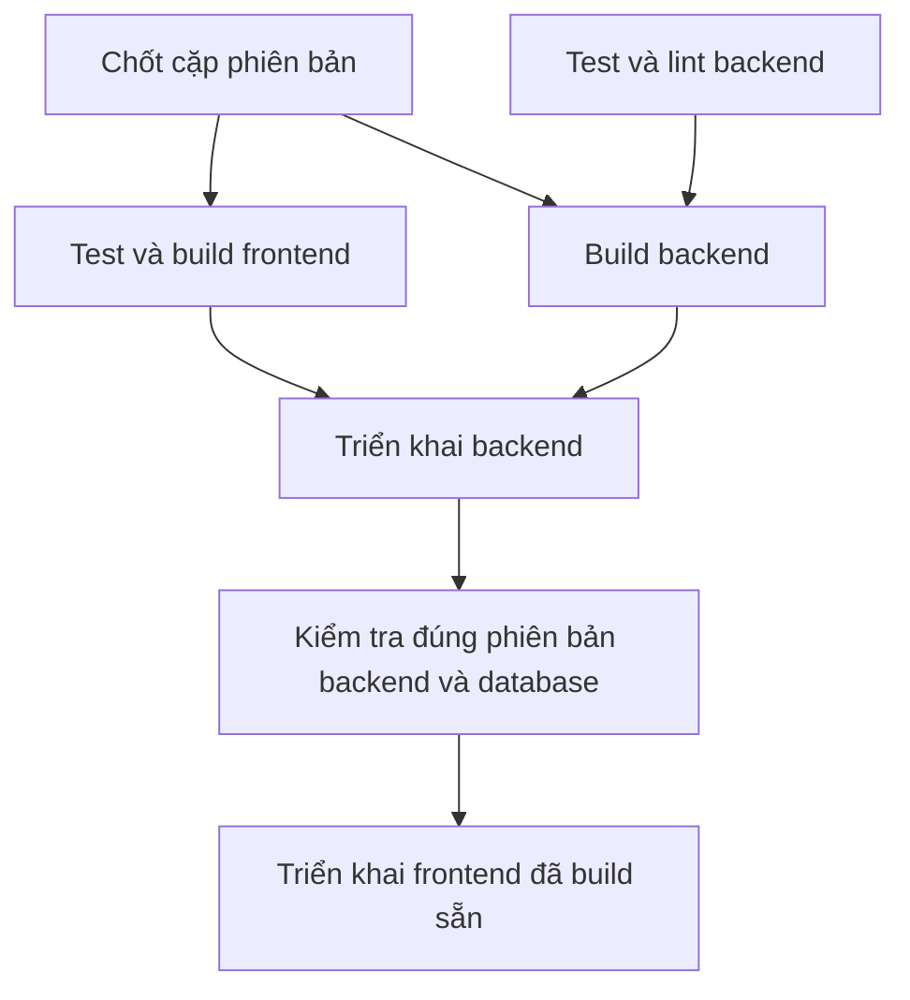

# Vận hành production: VPS và phát hành phối hợp

## 1. Tổng quan

- Repo điều phối: `thienbd203/pathnote` (local `pathnote-rust`). Frontend vẫn là
  `thienbd203/pathnote-web`; collaboration (Hocuspocus) triển khai riêng.
- Workflow `.github/workflows/deploy.yml` (**Pathnote coordinated release**): pull
  request chỉ chạy check; push `master` hoặc chạy thủ công trên `master` phát hành
  cặp phiên bản trong `.github/release.json`.
- VPS không cần Rust/Cargo: CI build binary musl `server` và `migration`, upload
  bằng SSH vào `/opt/pathnote-rust/releases/<RELEASE>`, symlink `current`.
- Database mới `pathnote_rust`; không chuyển dữ liệu Laravel, không đổi cấu hình
  Laravel đang chạy.

| Thành phần | Nơi chạy | Cổng / URL |
| --- | --- | --- |
| API Rust `pathnote-rust.service` (user `pathnote`) | `/opt/pathnote-rust/current` | `127.0.0.1:3000`, public qua Nginx HTTPS `/health` |
| PostgreSQL | VPS, chỉ localhost | `5432` |
| Frontend tĩnh | `/var/www/pathnote-web` (mặc định) | `https://pathnote.aphorisms.cloud` |
| Collaboration | triển khai riêng | `https://pathnote-collab.aphorisms.cloud/up` |
| Backup trước migration | `/var/backups/pathnote-rust` (link `/opt/pathnote-rust/backups`) | — |

Chỉ public SSH/HTTP/HTTPS. Tác vụ nền chạy trong Rust, không cần Redis/Horizon.
Media phục vụ qua API có kiểm tra quyền.

## 2. Chuẩn bị VPS lần đầu

Ubuntu/Debian, chạy bằng root hoặc sudo.

### 2.1 Gói và PostgreSQL

```sh
cat /etc/os-release
uname -m
sudo apt update
sudo apt install -y postgresql postgresql-contrib rsync python3 util-linux openssl ca-certificates nginx certbot python3-certbot-nginx
sudo systemctl enable --now postgresql
pg_lsclusters
sudo -u postgres psql -c 'SHOW listen_addresses;'
sudo -u postgres psql -c 'SHOW port;'
```

PostgreSQL chỉ nghe localhost; nếu khác, sửa `listen_addresses = 'localhost'` trong
`postgresql.conf` của cluster rồi restart. Dùng bản Ubuntu đang hỗ trợ
([hướng dẫn](https://www.postgresql.org/download/linux/ubuntu/)).

Tạo role/database, nhập password qua prompt (không ghi vào history):

```sh
sudo -u postgres psql
```

```sql
CREATE ROLE pathnote LOGIN;
\password pathnote
CREATE DATABASE pathnote_rust OWNER pathnote;
\q
```

```sh
psql -h 127.0.0.1 -U pathnote -d pathnote_rust -W -c 'SELECT current_database();'
```

Role không cần SUPERUSER; database owner đủ chạy migration và tạo bảng phiên.

Client PostgreSQL phải cùng major version với server (`pg_dump` cũ hơn sẽ từ chối
chạy), ví dụ DB 17:

```sh
sudo apt install postgresql-client-17
/usr/bin/pg_dump --version
sudo -u postgres psql -Atc 'SHOW server_version;'
```

Helper dùng `/usr/bin/pg_dump` (trên Debian là wrapper chọn client theo cluster).
DB không phải local cluster thì cấu hình client mặc định đúng major version.
[Tài liệu pg_dump](https://www.postgresql.org/docs/current/app-pgdump.html).

### 2.2 User, thư mục, khóa JWT

User `pathnote` chạy ứng dụng; `deploy` nhận artifact. Đã có user deploy thì dùng
lại, sửa tên trong sudoers và `SSH_USER`.

```sh
sudo useradd --system --user-group --no-create-home --shell /usr/sbin/nologin pathnote
sudo adduser --disabled-password --gecos '' deploy
sudo usermod -aG pathnote deploy
sudo install -d -o deploy -g pathnote -m 2750 /opt/pathnote-rust /opt/pathnote-rust/releases
sudo install -d -o root -g pathnote -m 750 /opt/pathnote-rust/shared /opt/pathnote-rust/shared/keys
sudo install -d -o pathnote -g pathnote -m 750 /opt/pathnote-rust/shared/media
```

Thêm public key riêng cho CI vào `/home/deploy/.ssh/authorized_keys` (thư mục 700,
file 600, owner deploy); private key chỉ đưa vào GitHub Secret. Đăng nhập SSH lại để
nhóm mới có hiệu lực.

Tạo khóa JWT **một lần**, không ghi đè khi deploy:

```sh
sudo sh -c 'test ! -e /opt/pathnote-rust/shared/keys/access-token.pem && umask 027 && openssl genpkey -algorithm RSA -pkeyopt rsa_keygen_bits:3072 -out /opt/pathnote-rust/shared/keys/access-token.pem'
sudo chown root:pathnote /opt/pathnote-rust/shared/keys/access-token.pem
sudo chmod 640 /opt/pathnote-rust/shared/keys/access-token.pem
```

### 2.3 Env, systemd, helper backup

Từ Mac, trong repo Rust (thay VPS_HOST, thêm port nếu khác 22):

```sh
scp deploy/production.env.example deploy/pathnote-rust.service deploy/database-backup.py deploy/nginx.conf.example root@VPS_HOST:/tmp/
```

Trên VPS:

```sh
sudo install -o root -g pathnote -m 640 /tmp/production.env.example /opt/pathnote-rust/shared/.env
sudo nano /opt/pathnote-rust/shared/.env
sudo install -m 644 /tmp/pathnote-rust.service /etc/systemd/system/pathnote-rust.service
sudo install -d -o root -g root -m 700 /var/backups/pathnote-rust
sudo install -o root -g root -m 755 /tmp/database-backup.py /usr/local/sbin/pathnote-db-backup
sudo ln -s /var/backups/pathnote-rust /opt/pathnote-rust/backups
sudo systemctl daemon-reload
sudo systemctl enable pathnote-rust.service
```

Chưa start service; binary lên ở lần deploy đầu. Quy tắc `.env`:

- Điền DATABASE_URL, Google client ID/secret, FRONTEND_URL, GOOGLE_REDIRECT_URL,
  JWT_ISSUER theo domain thật. Giữ `APP_BIND=127.0.0.1:3000`, `COOKIE_SECURE=true`.
- DATABASE_URL là URL literal một dòng, có hoặc không dấu nháy, không interpolation;
  percent-encode ký tự đặc biệt (`@` → `%40`). File do dotenv/systemd đọc, không
  `source` trong shell; helper không chạy các biến khác.
- Thêm callback Rust vào Authorized redirect URIs trên Google Console (có thể dùng
  chung OAuth client với Laravel). Khóa JWT và MEDIA_ROOT nằm ngoài releases.
- Dịch/IPA chưa chạy thì để trống TRANSLATION_URL/PRONUNCIATION_URL; có rồi thì dùng
  địa chỉ localhost trong mẫu. Realtime cần COLLABORATION_URL WSS và cùng
  COLLABORATION_SECRET giữa Rust/Hocuspocus; Hocuspocus trỏ API nội bộ sang Rust.

Helper backup do root cài cố định; CI không upload/thay nó. Nó chạy `pg_dump` bằng
user ứng dụng (không phải root), tách URL thành các biến libpq (`PGHOST`, `PGPORT`,
`PGUSER`, `PGPASSWORD`, `PGDATABASE`); không truyền nguyên URL vào `PGDATABASE`.
Thông tin kết nối không vào tham số hay log. Helper ghi dump root mode 600,
giữ 5 bản hoàn tất mới nhất; dump lỗi/rỗng làm
deploy dừng trước migration. Đổi DEPLOY_PATH/user thì root sửa hằng số trong helper
cùng sudoers. Không cấp sudo chạy helper từ thư mục releases (deploy có quyền ghi).

Sudoers: `sudo visudo -f /etc/sudoers.d/pathnote-rust`

```sudoers
deploy ALL=(root) NOPASSWD: /usr/bin/systemctl restart pathnote-rust.service, /usr/bin/systemctl stop pathnote-rust.service, /usr/local/sbin/pathnote-db-backup *
deploy ALL=(pathnote) NOPASSWD: /usr/bin/test -r /opt/pathnote-rust/shared/.env, /usr/bin/test -r /opt/pathnote-rust/shared/keys/access-token.pem, /usr/bin/test -w /opt/pathnote-rust/shared/media, /opt/pathnote-rust/releases/*/migration up
```

```sh
sudo chmod 440 /etc/sudoers.d/pathnote-rust
sudo visudo -cf /etc/sudoers.d/pathnote-rust
```

VPS đã có từ trước: cài helper, client và sudoers **trước lần deploy tiếp theo**.
Khi helper thay đổi, upload lại `deploy/database-backup.py` và chạy lại lệnh
`install` ở mục 2.3; chỉ chạy lại CI không cập nhật helper trên VPS.
Helper hỗ trợ URL một host (kể cả IPv6), database và credential percent-encoded;
query hỗ trợ `sslmode`, `sslrootcert`, `sslcert`, `sslkey`, `application_name`,
`options`, `connect_timeout`, `target_session_attrs`. Option khác bị từ chối,
không âm thầm bỏ qua cấu hình kết nối/TLS.

### 2.4 Domain và Nginx HTTPS

`rust-api.example.com` là placeholder; thay ở mọi chỗ trong mẫu và env. Trỏ DNS về
VPS, tạo `sudo nano /etc/nginx/sites-available/pathnote-rust`:

```nginx
server {
    listen 80;
    server_name rust-api.example.com;
    location / { proxy_pass http://127.0.0.1:3000; }
}
```

```sh
sudo ln -s /etc/nginx/sites-available/pathnote-rust /etc/nginx/sites-enabled/pathnote-rust
sudo nginx -t
sudo systemctl reload nginx
sudo certbot --nginx -d rust-api.example.com
```

Sau đó áp thiết lập từ `nginx.conf.example` vào site HTTPS certbot đã tạo, giữ
redirect HTTP → HTTPS, `nginx -t` rồi reload. Không ghi đè site Laravel.

### 2.5 pgAdmin trên Mac qua SSH tunnel

Không cài giao diện quản trị trên VPS, không mở 5432. Add New Server:

| Tab | Trường | Giá trị |
| --- | --- | --- |
| General | Name | Pathnote VPS |
| Connection | Host / Port | 127.0.0.1 / 5432 |
| Connection | Maintenance database / Username | pathnote_rust / pathnote |
| Connection | Password | Password database đã tạo |
| SSH Tunnel | Use SSH tunneling | Yes |
| SSH Tunnel | Tunnel host / Port | VPS_HOST / cổng SSH |
| SSH Tunnel | Username | User SSH của anh |
| SSH Tunnel | Authentication / Identity file | Identity file / khóa SSH trên Mac |

[Tài liệu pgAdmin](https://www.pgadmin.org/docs/pgadmin4/latest/server_dialog.html).

## 3. Secrets và variables GitHub

Workflow không tự tạo/sửa secrets hay variables.

**Repo điều phối — Repository variables/secret** (job build không dùng Environment):

| Tên | Giá trị |
| --- | --- |
| Variable `VITE_API_URL` | Origin API production (bắt buộc cho build frontend) |
| Variable `BUILD_RUNNER` | Mặc định `ubuntu-24.04` (x86_64); `ubuntu-24.04-arm` cho aarch64 |
| Secret `FRONTEND_READ_TOKEN` | Chỉ khi frontend private: token Contents: read cho repo frontend, không quyền ghi/Actions: write. Public thì dùng `github.token` mặc định |

Token chỉ dùng checkout ở job build; không lưu vào cấu hình Git, không đưa token
hay SSH key vào artifact.

**Repo điều phối — Environment `production`:**

| Tên | Giá trị |
| --- | --- |
| Secret `SSH_HOST` | IP hoặc hostname VPS (không protocol/port) |
| Secret `SSH_USER` | deploy |
| Secret `SSH_PORT` | 22 hoặc cổng thực tế |
| Secret `SSH_PRIVATE_KEY` | Private key CI, không passphrase |
| Secret `SSH_KNOWN_HOSTS` | Host key VPS đã xác minh |
| Variable `HEALTHCHECK_URL` | `https://DOMAIN_API_RUST/health` (bắt buộc, không `/` cuối) |
| Variable `DEPLOY_PATH` | Mặc định `/opt/pathnote-rust`; đổi thì sửa service, env, sudoers, helper |
| Variable `WEB_DEPLOY_PATH` | Mặc định `/var/www/pathnote-web` |
| Variable `WEB_SITE_URL` | Mặc định `https://pathnote.aphorisms.cloud` |
| Variable `COLLABORATION_HEALTHCHECK_URL` | Mặc định `https://pathnote-collab.aphorisms.cloud/up`; chỉ HTTPS |
| Secrets `WEB_SSH_HOST`, `WEB_SSH_USER`, `WEB_SSH_PORT`, `WEB_SSH_PRIVATE_KEY`, `WEB_SSH_KNOWN_HOSTS` | Chỉ khi host/user/key frontend khác backend |

Không đặt `WEB_SSH_*` thì dùng lại `SSH_*`: chỉ đúng khi cùng host, cùng user/key và
user đó có quyền với thư mục frontend; khác thì điền đủ bộ.

Lấy host key từ phiên SSH đã tin cậy trên VPS:

```sh
sudo cat /etc/ssh/ssh_host_ed25519_key.pub
sudo ssh-keygen -lf /etc/ssh/ssh_host_ed25519_key.pub
```

`SSH_KNOWN_HOSTS` dạng `VPS_HOST ssh-ed25519 PUBLIC_KEY` (port 22) hoặc
`[VPS_HOST]:PORT ssh-ed25519 PUBLIC_KEY`, đúng hostname/IP của SSH_HOST, đối chiếu
fingerprint qua kênh tin cậy. Workflow bắt buộc host key khớp; không dùng
`ssh-keyscan` để tin host key mới lúc phát hành.

**Repo frontend:** đặt `VITE_API_URL` ở Repository variables. Workflow frontend chỉ
test/format/build, không dùng SSH secrets, không tự triển khai.

Khi bật luồng này lần đầu: cấu hình đủ bảng trên → push workflow frontend CI-only
**trước** → kiểm tra SHA frontend trong manifest đã có trên GitHub → mới push
workflow điều phối (push này phát hành ngay cặp đã chốt).

## 4. Phát hành phối hợp



### 4.1 `.github/release.json`

```json
{
  "frontend_repository": "thienbd203/pathnote-web",
  "frontend_sha": "<40 ký tự>",
  "breaking_migration": true,
  "collaboration_sha": "<40 ký tự>"
}
```

Đúng bốn khóa; SHA đầy đủ 40 ký tự hex; `breaking_migration` là boolean JSON.
Backend là commit đang chạy workflow. Cặp SHA và release ID
(`YYYYmmddHHMMSS-RUN_ID-ATTEMPT`) hiện ở Summary của Actions. Không lấy nhánh
frontend mới nhất, không lấy artifact "lượt gần nhất", không build lại frontend
ở bước triển khai. Commit frontend/collaboration phải có trên GitHub trước.

### 4.2 Thứ tự

Đổi schema Tiptap hoặc cần cả ba phía: **collaboration → backend → frontend**.

1. Push collaboration đã tương thích, chờ `/up` trả đúng SHA (workflow Rust không
   triển khai collaboration).
2. Push frontend để chạy CI; production chưa đổi.
3. Điền `frontend_sha`, `collaboration_sha` vào `.github/release.json` cùng thay
   đổi backend, review, push `master`.
4. Workflow: check backend + build frontend song song; build backend sau check.
   Chỉ khi **cả hai build** thành công mới triển khai backend.
5. `.github/deploy.sh` kiểm tra checksum, SHA, kiến trúc; backup; migration; đổi
   `current`; restart; health qua `http://127.0.0.1:3000/health` và
   `HEALTHCHECK_URL` phải `status`/`database` ok và `version` đúng SHA. Giữ 3
   release gần nhất.
6. Job frontend tải artifact của chính lượt chạy, kiểm checksum và SHA frontend,
   kiểm tra backend và collaboration đúng SHA trước upload và ngay trước kích hoạt.

Chỉ sửa frontend: cập nhật SHA trong manifest rồi phát hành qua backend. Chỉ sửa
backend: giữ SHA frontend. Phát hành lại cặp đã chốt: chạy thủ công trên `master`.
Lượt production tuần tự qua `concurrency`, không hủy lượt đang chạy; lượt đang xếp
hàng có thể bị thay bằng lượt mới, nhưng mỗi lượt giữ nguyên cặp SHA của nó.
Backend mới phải phục vụ được frontend cũ và các tab đang mở.

### 4.3 `breaking_migration`

Bật `true` khi migration thêm NOT NULL không default, xóa/đổi dữ liệu, hoặc làm
binary cũ không chạy được.

- `true`: dừng Rust → backup → migration → đổi current → khởi động → health.
- `false`: backup → migration khi binary cũ vẫn phục vụ → đổi current → restart.
  Chỉ dùng khi schema mới vẫn tương thích binary cũ, kể cả khi rollback code.

Giữ `true` cho tới khi người vận hành xác nhận migration đã chạy và release kế tiếp
chỉ có thay đổi tương thích. Không tự đổi `false` sau build.

### 4.4 Backup và restore

Mỗi deploy gọi `sudo -n /usr/local/sbin/pathnote-db-backup "$RELEASE"` trước migration,
tạo `/opt/pathnote-rust/backups/<RELEASE>.dump` và log `Backup ready: ...`. Dump
này không chứa roles, không thay backup định kỳ.

Restore (người vận hành dừng service và mọi writer, gồm collaboration; chọn đúng
dump của release; xác minh DB đích; DB khác tên/role/máy thì sửa kết nối, không
dùng nguyên ví dụ):

```sh
sudo systemctl stop pathnote-rust.service
# Thay RELEASE bằng release lỗi; giữ service dừng nếu restore thất bại.
sudo cat /opt/pathnote-rust/backups/RELEASE.dump | sudo -u postgres pg_restore --exit-on-error --single-transaction --clean --if-exists --dbname=pathnote_rust
```

Restore thành công thì trỏ `current` về release cũ khớp schema, khởi động service,
kiểm tra health. Restore đưa dữ liệu về lúc backup; cân nhắc các lượt ghi sau đó.

Backup thủ công ngoài releases (lệnh ghi đè cùng tên; dùng tên theo ngày để giữ
nhiều bản). Sao lưu thêm `shared/media` và khóa JWT ra nơi riêng tư ngoài VPS; thử
phục hồi trước khi cần.

```sh
sudo install -d -m 700 /var/backups/pathnote-rust
sudo sh -c 'umask 077; sudo -u postgres pg_dump -Fc pathnote_rust > /var/backups/pathnote-rust/database.dump'
```

### 4.5 Kiểm tra sau release

```sh
sudo systemctl status pathnote-rust.service --no-pager -l
sudo journalctl -u pathnote-rust.service -n 100 --no-pager
curl -fsS http://127.0.0.1:3000/health
curl -fsS https://DOMAIN_API_RUST/health
```

Thử Google login thật từ frontend (tests dùng Google giả lập, không thay bước này),
mở note, ôn flashcard.

### 4.6 Kiểm tra local

```sh
python3 -m unittest discover -s deploy/tests -v
actionlint .github/workflows/deploy.yml
bash -n .github/deploy.sh
```

Test topology cần Ruby (thiếu thì skip). Fixture kích hoạt/rollback chỉ chạy trên
Linux root với thư mục giả; macOS skip. Không test nào kết nối VPS. Cache Cargo tách
theo runner, target, compiler, Cargo.lock, commit; vẫn chạy đủ test/lint/build.

## 5. Checklist trước release có migration không tương thích ngược

Người vận hành tự làm trên production (agent không chạy thay), hoàn thành trước
khi cho phát hành. Áp dụng cho lần đầu có `m20261016_*` và mọi release
`breaking_migration: true`.

1. Trên **đúng database production**:

   ```sql
   SELECT lower('É') = 'é';
   ```

   Phải là `true`; `false` thì dừng, xử lý locale trước. Migration tạo khóa bằng
   PostgreSQL lower(), Rust dùng to_lowercase(); locale C có thể làm khóa chữ có dấu
   lệch nhau. Đây là kiểm tra tối thiểu, không chứng minh mọi ký tự Unicode.
2. Xác minh client PostgreSQL, helper root-owned, sudoers, thư mục backup (mục 2).
   Backup thử với release ID riêng, không trùng CI:
   `sudo /usr/local/sbin/pathnote-db-backup "$(date -u +%Y%m%d%H%M%S)-0-1"`.
   Dump phải tồn tại, không rỗng, owner root/mode 600, đọc được bằng
   `sudo pg_restore --list /opt/pathnote-rust/backups/ID.dump`.
3. Giữ `breaking_migration: true`. Sắp xếp thời gian dừng ghi; dừng collaboration và
   writer khác để không nhận sửa note không lưu được khi API dừng.
4. Khi CI chạy, xác nhận `Backup ready` đúng release ID, trước bước migration. Phục
   hồi dùng dump của chính release đó; backup thử chỉ để kiểm cấu hình.
5. Release thành công: kiểm tra đăng nhập, mở note, ôn flashcard rồi mới bật lại
   writer. Lỗi sau migration: giữ writer dừng, làm restore (4.4); không chỉ khởi
   động binary cũ.

Migration gộp Flashcard đã thay khóa memory, không tương thích backend trước đó:
sau khi migration chạy, không dựa vào rollback binary cũ.

## 6. Rollback và sự cố

Pipeline chỉ khôi phục **code**, **không rollback database**; migration được giữ.

| Tình huống | Hành vi |
| --- | --- |
| Check/build một bên lỗi | Không triển khai bên nào |
| Lỗi trước migration (`true`, đã dừng service) | Khởi động lại release cũ; lần cài đầu giữ dừng |
| `false`, lỗi sau đổi current/health | Trỏ lại release cũ và restart; schema mới được giữ |
| `true`, migration đã được gọi (kể cả lỗi giữa chừng) hoặc health lỗi | Giữ service dừng, không trả code cũ; script in tên dump và lệnh restore mẫu |
| Lần deploy đầu lỗi | Dừng service, xóa `current` |
| Backend lỗi, trả bản cũ hoặc DB không khỏe | Frontend mới không được kích hoạt; HTTP 200 chưa đủ |
| Collaboration sai SHA, lỗi HTTP, timeout | Dừng frontend; backend đã khỏe được giữ |
| Frontend lỗi | Script frontend khôi phục bản cũ; backend mới giữ nguyên; job báo lỗi để sửa và phát hành lại |

Sau sự cố migration breaking: xác minh DB đích, dừng mọi writer, restore (4.4),
chọn code khớp schema rồi mới restart. Log và health: mục 4.5.
