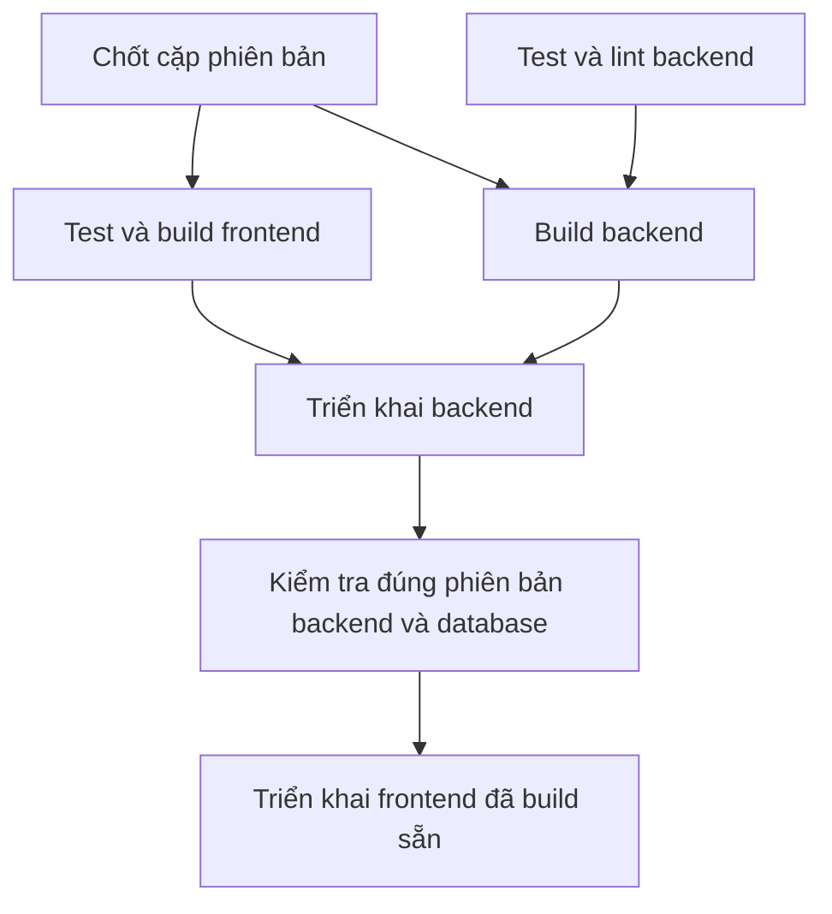

# Phát hành chung frontend và backend

Luồng phát hành phối hợp frontend và backend qua một workflow điều phối.

Repo GitHub điều phối là `thienbd203/pathnote` (thư mục local `pathnote-rust`).
Repo frontend vẫn là `thienbd203/pathnote-web`; không cần gộp hai repository.



## Cách chọn phiên bản

`.github/release.json` ghi commit frontend đầy đủ 40 ký tự. Backend lấy chính
commit đang chạy workflow. Hai giá trị hiện trong phần Summary của GitHub Actions.
Không lấy nhánh frontend mới nhất trong lúc triển khai, không tìm artifact của
“lượt chạy gần nhất”, không build lại frontend ở bước triển khai.

Manifest hiện trỏ tới commit frontend `246afddc2feae670e093d698a2e086c37da0e062`,
bao gồm workflow frontend CI-only. Commit frontend phải có trên GitHub trước khi
workflow điều phối có thể checkout.

Khi thêm tính năng cần cả hai phía:

1. Commit và push frontend để chạy CI; bước này chưa đổi website production.
2. Điền SHA frontend đó vào `.github/release.json` của backend, cùng thay đổi
   backend tương ứng, review rồi push `master`.
3. Workflow chung chạy kiểm thử backend và chuẩn bị frontend song song.
   Frontend build xong được lưu thành artifact, backend tiếp tục chạy.
4. Khi **cả hai build thành công**, backend mới được upload/triển khai.
5. Script backend kiểm tra service, database và SHA qua localhost lẫn HTTPS.
   Chỉ khi job đó thành công, job frontend mới được chạy.
6. Job frontend tải artifact của chính lượt chạy, kiểm tra checksum, SHA frontend,
   kiểm tra lại đúng SHA backend đang chạy trước khi upload và trước khi kích hoạt.

Chỉ sửa frontend cũng phát hành qua cùng luồng: cập nhật SHA trong manifest rồi
chạy workflow backend. Chỉ sửa backend thì giữ SHA frontend hiện tại. Có thể chạy
thủ công workflow trên `master` để phát hành lại chính cặp đã chốt.

Các thay đổi frontend mới hơn SHA trong manifest không tự nhập vào đợt phát hành.
Hai lượt phát hành production được tuần tự hóa bằng `concurrency`; lượt đang chạy
không bị hủy giữa lúc triển khai. GitHub có thể thay thế lượt đang xếp hàng bằng
lượt mới hơn, nhưng từng lượt được chạy luôn giữ nguyên cặp SHA của chính nó.

## Cấu hình cần có trước khi bật

### Repo điều phối backend

**Repository variables** (không chỉ đặt trong Environment, vì dùng ở job build):

| Variable | Giá trị |
| --- | --- |
| `VITE_API_URL` | Origin API production, giống giá trị build frontend hiện tại |
| `BUILD_RUNNER` | Tùy chọn: mặc định `ubuntu-24.04`; ARM64 dùng `ubuntu-24.04-arm` |

**Repository secret**:

| Secret | Giá trị |
| --- | --- |
| `FRONTEND_READ_TOKEN` | Nếu frontend private: token chỉ có Contents: read cho repo frontend. Không cần quyền ghi hoặc Actions: write. Nếu public có thể dùng `github.token` mặc định. |

Token chỉ được dùng checkout source ở job build, không được lưu vào cấu hình Git.
Không đưa token hay SSH key vào artifact.

**Environment `production`**: giữ các SSH secrets và `HEALTHCHECK_URL`,
`DEPLOY_PATH` của backend theo hướng dẫn hiện tại. Thêm cấu hình frontend:

| Variable/secret | Giá trị |
| --- | --- |
| Variable `WEB_DEPLOY_PATH` | Mặc định `/var/www/pathnote-web` |
| Variable `WEB_SITE_URL` | Mặc định `https://pathnote.aphorisms.cloud` |
| Secrets `WEB_SSH_HOST`, `WEB_SSH_USER`, `WEB_SSH_PORT` | Dùng giá trị của frontend hiện tại nếu khác backend |
| Secrets `WEB_SSH_PRIVATE_KEY`, `WEB_SSH_KNOWN_HOSTS` | Khóa frontend và host key đã xác minh nếu khác backend |

Nếu không đặt `WEB_SSH_*`, workflow dùng lại `SSH_*` backend. Cách dùng lại chỉ
phù hợp khi cùng host, cùng user/key và user đó đã có quyền với thư mục frontend.
Nếu host/user khác, điền đủ bộ `WEB_SSH_*`. Không dùng `ssh-keyscan` để tự tin cậy
một host key mới trong lúc phát hành.

### Repo frontend

Đặt `VITE_API_URL` ở **Repository variables** để CI chạy được mà không cần mở
Environment production. Workflow frontend sau thay đổi chỉ test/format/build,
không dùng SSH secrets và không kích hoạt bản mới.

### Thứ tự đưa cấu hình CI/CD mới lên GitHub sau khi review

1. Hoàn thiện các variables/secrets bên trên.
2. Commit và push workflow frontend CI-only **trước**, để tắt đường triển khai
   frontend độc lập. Website hiện tại tiếp tục giữ bản cũ.
3. Kiểm tra SHA frontend trong manifest đã có trên GitHub; có thể cập nhật tới
   commit frontend CI-only vừa được review.
4. Sau đó commit và push workflow điều phối backend. Push này sẽ kích hoạt phát
   hành cặp đã chốt, vì vậy cần hoàn thành cấu hình trước bước đó.

Secrets và variables cần cấu hình riêng trên GitHub; source workflow không tự
tạo hoặc thay đổi chúng.

## Khi có lỗi

- Check hoặc build một bên lỗi: không chạy bước triển khai của cả hai bên.
- Backend triển khai hoặc healthcheck lỗi: frontend mới không được kích hoạt.
  Chỉ khôi phục **code** cũ với migration tương thích. Chế độ breaking giữ
  service dừng nếu migration đã bắt đầu, chờ người vận hành phục hồi DB.
- Frontend lỗi: script frontend khôi phục bản frontend cũ; backend mới đã khỏe
  vẫn được giữ lại. Job báo thất bại để có thể sửa và phát hành lại.
- Kiểm tra backend trả bản cũ hoặc database không khỏe cũng là lỗi; chỉ HTTP 200
  chưa đủ để cho frontend lên.

Đây là phát hành theo thứ tự, không phải thay cả hai dịch vụ đồng thời. Backend
mới vẫn cần phục vụ frontend cũ và các tab đã mở. Migration được giữ lại khi
rollback code; pipeline **không rollback database**. Các migration gộp Flashcard
đã thay khóa memory, không tương thích với backend trước thay đổi đó: trước khi
phát hành cần chọn phương án chuyển database có kiểm soát và khôi phục phù hợp,
không dựa vào rollback binary cũ sau khi migration đã chạy.

## Cache và kiểm chứng

Cache Cargo check và release được tách theo runner, kiến trúc/target, compiler,
Cargo.lock và commit. Restore dùng cùng compiler/dependency để tái dùng build
trước, nhưng vẫn chạy đầy đủ test/lint/build. Cache không thay cho điều kiện chờ.

Các kiểm tra local:

```sh
python3 -m unittest discover -s deploy/tests -v
actionlint .github/workflows/deploy.yml
bash -n .github/deploy.sh
```

Các test topology dùng parser YAML chuẩn của Ruby; GitHub hosted Ubuntu có Ruby.
Nếu không có Ruby thì nhóm test này báo skip. Fixture kích hoạt/rollback service
hiện có chỉ chạy trên Linux root và dùng thư mục giả; macOS báo skip. Không có
lệnh test nào kết nối VPS hay chạy deployment production.

Tham khảo: [job dependencies](https://docs.github.com/en/actions/how-tos/write-workflows/choose-what-workflows-do/use-jobs),
[workflow artifacts](https://docs.github.com/en/actions/tutorials/store-and-share-data),
[Actions cache](https://github.com/actions/cache).

## Khôi phục database từ backup trước migration

Mỗi lần deploy tạo custom dump trước migration. Bản hoàn tất có tên
`/opt/pathnote-rust/backups/<RELEASE>.dump` (owner root, mode 600, giữ 5 bản).
Backup lỗi hoặc rỗng thì không chạy migration. Cài helper/client theo
[README VPS](README.md#backup-bắt-buộc-trước-migration) trước khi phát hành.

Khi cần phục hồi, người vận hành dừng service và mọi writer (gồm collaboration),
chọn đúng dump của release, xác minh DB đích rồi mới chạy, ví dụ DB local
`pathnote_rust` và role `pathnote` theo mẫu:

```sh
sudo systemctl stop pathnote-rust.service
# Thay RELEASE bằng release lỗi; giữ service dừng nếu restore thất bại.
sudo cat /opt/pathnote-rust/backups/RELEASE.dump | sudo -u postgres pg_restore --exit-on-error --single-transaction --clean --if-exists --dbname=pathnote_rust
```

Sau restore thành công, trỏ `current` về release cũ khớp schema rồi khởi động
service và kiểm tra health. Nếu DB ngoài máy hoặc khác tên/role, sửa kết nối đích;
không dùng nguyên ví dụ. Restore quay dữ liệu về thời điểm backup, cần cân nhắc
các lượt ghi mới sau đó. Dump này không chứa roles và không thay backup định kỳ.

## Migration không tương thích ngược

Manifest bắt buộc có boolean JSON `breaking_migration`. Release đầu tiên chứa
`m20261016_*` đang đặt `true`. Mọi migration thêm NOT NULL không có default,
xóa/đổi dữ liệu hoặc làm binary cũ không thể chạy đều phải bật cờ này.
Với `true`: dừng Rust → backup → migration → đổi current → khởi động → health.
Với `false`: backup → migration khi binary cũ phục vụ → đổi current → restart;
chỉ dùng nếu schema còn tương thích binary cũ, kể cả khi rollback code.

- Lỗi trước khi bắt đầu migration: nếu đã dừng và có release cũ, khởi động lại
  release đó; lần cài đầu giữ service dừng.
- Lệnh migration đã được gọi, kể cả trả lỗi giữa chừng: giữ service dừng,
  không đổi current về code cũ. Health thất bại cũng giữ service dừng.
  Script báo tên dump và lệnh restore mẫu; người vận hành xác minh DB và dừng
  mọi writer, restore thành công rồi chọn code khớp schema mới được restart.

Cờ true vẫn được giữ cho tới khi người vận hành xác nhận migration đầu đã chạy
và release tiếp theo chỉ chứa thay đổi tương thích. Không tự đổi false sau build.
